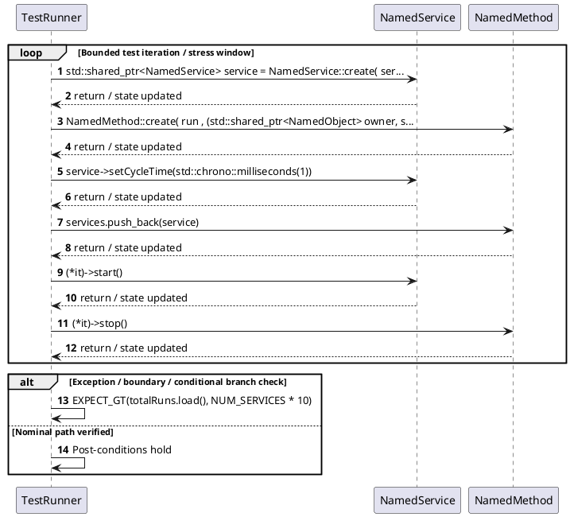

# Test Case: `NamedMethodAndServiceTest.MultiThreadStress`

| Property | Value |
| :--- | :--- |
| **Module** | `named` |
| **Source File** | `cmake-projects/named/test/TestNamedMethodAndService.cpp` (lines 101–136) |
| **Category** | Determinism, Fuzzing, Concurrency & Stress (`CS-0100.7`, `CS-0100.10`, `CS-0100.11`, `CS-0100.12`) |
| **Traceability** | See module specification (`FE-*` / `TSK-*`) |
| **Async Telemetry** | Standard GTest / CTest stdout |

## Summary

Executes verification scenario `NamedMethodAndServiceTest.MultiThreadStress` defined in `cmake-projects/named/test/TestNamedMethodAndService.cpp`.

## Sequence Diagram

## Observed Operations

- `std::shared_ptr<NamedService> service = NamedService::create("service_" + std::to_string(i), root)`
- `NamedMethod::create("run", [&](std::shared_ptr<NamedObject> owner, std::shared_ptr<NamedObject> args) {`
- `service->setCycleTime(std::chrono::milliseconds(1))`
- `services.push_back(service)`
- `(*it)->start()`
- `(*it)->stop()`

## Verification Assertions

- `EXPECT_GT(totalRuns.load(), NUM_SERVICES * 10)`

---

[Back to `named` Tests Overview](../named.md)
