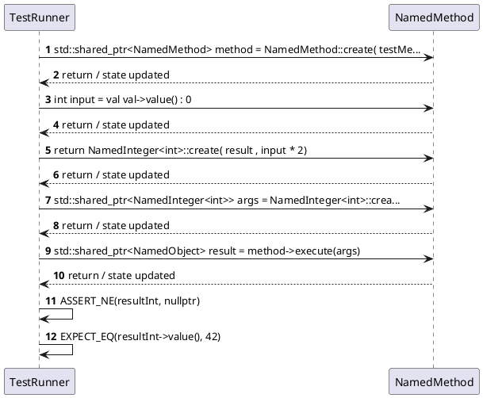

# Test Case: `NamedMethodAndServiceTest.NamedMethodBasic`

| Property | Value |
| :--- | :--- |
| **Module** | `named` |
| **Source File** | `cmake-projects/named/test/TestNamedMethodAndService.cpp` (lines 20–33) |
| **Category** | Unit & Regression Verification |
| **Traceability** | See module specification (`FE-*` / `TSK-*`) |
| **Async Telemetry** | Standard GTest / CTest stdout |

## Summary

Executes verification scenario `NamedMethodAndServiceTest.NamedMethodBasic` defined in `cmake-projects/named/test/TestNamedMethodAndService.cpp`.

## Sequence Diagram

## Observed Operations

- `std::shared_ptr<NamedMethod> method = NamedMethod::create("testMethod",  {`
- `int input = val ? val->value() : 0`
- `return NamedInteger<int>::create("result", input * 2)`
- `std::shared_ptr<NamedInteger<int>> args = NamedInteger<int>::create("args", 21)`
- `std::shared_ptr<NamedObject> result = method->execute(args)`

## Verification Assertions

- `ASSERT_NE(resultInt, nullptr)`
- `EXPECT_EQ(resultInt->value(), 42)`

---

[Back to `named` Tests Overview](../named.md)
