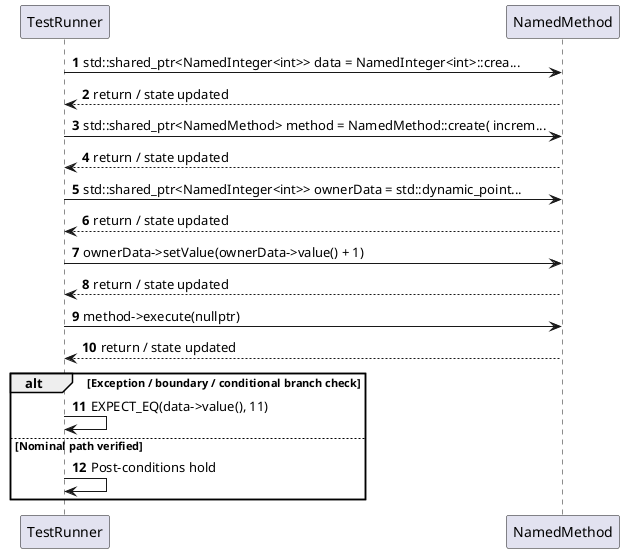

# Test Case: `NamedMethodAndServiceTest.NamedMethodOwnerAccess`

| Property | Value |
| :--- | :--- |
| **Module** | `named` |
| **Source File** | `cmake-projects/named/test/TestNamedMethodAndService.cpp` (lines 35–47) |
| **Category** | Unit & Regression Verification |
| **Traceability** | See module specification (`FE-*` / `TSK-*`) |
| **Async Telemetry** | Standard GTest / CTest stdout |

## Summary

Executes verification scenario `NamedMethodAndServiceTest.NamedMethodOwnerAccess` defined in `cmake-projects/named/test/TestNamedMethodAndService.cpp`.

## Sequence Diagram

## Observed Operations

- `std::shared_ptr<NamedInteger<int>> data = NamedInteger<int>::create("data", 10, root)`
- `std::shared_ptr<NamedMethod> method = NamedMethod::create("increment",  {`
- `std::shared_ptr<NamedInteger<int>> ownerData = std::dynamic_pointer_cast<NamedInteger<int>>(owner->getChild("data"))`
- `ownerData->setValue(ownerData->value() + 1)`
- `method->execute(nullptr)`

## Verification Assertions

- `EXPECT_EQ(data->value(), 11)`

---

[Back to `named` Tests Overview](../named.md)
