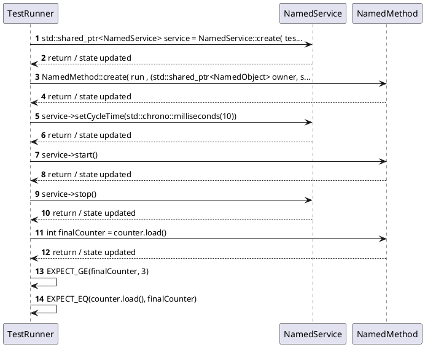

# Test Case: `NamedMethodAndServiceTest.NamedServiceLifecycle`

| Property | Value |
| :--- | :--- |
| **Module** | `named` |
| **Source File** | `cmake-projects/named/test/TestNamedMethodAndService.cpp` (lines 49–69) |
| **Category** | Unit & Regression Verification |
| **Traceability** | See module specification (`FE-*` / `TSK-*`) |
| **Async Telemetry** | Standard GTest / CTest stdout |

## Summary

Executes verification scenario `NamedMethodAndServiceTest.NamedServiceLifecycle` defined in `cmake-projects/named/test/TestNamedMethodAndService.cpp`.

## Sequence Diagram

## Observed Operations

- `std::shared_ptr<NamedService> service = NamedService::create("testService", root)`
- `NamedMethod::create("run", [&](std::shared_ptr<NamedObject> owner, std::shared_ptr<NamedObject> args) {`
- `service->setCycleTime(std::chrono::milliseconds(10))`
- `service->start()`
- `service->stop()`
- `int finalCounter = counter.load()`

## Verification Assertions

- `EXPECT_GE(finalCounter, 3)`
- `EXPECT_EQ(counter.load(), finalCounter)`

---

[Back to `named` Tests Overview](../named.md)
