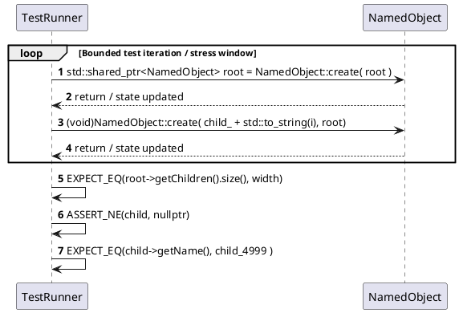

# Test Case: `NamedObjectStress.WideHierarchy`

| Property | Value |
| :--- | :--- |
| **Module** | `named` |
| **Source File** | `cmake-projects/named/test/TestNamedObjectStress.cpp` (lines 41–70) |
| **Category** | Determinism, Fuzzing, Concurrency & Stress (`CS-0100.7`, `CS-0100.10`, `CS-0100.11`, `CS-0100.12`) |
| **Traceability** | See module specification (`FE-*` / `TSK-*`) |
| **Async Telemetry** | Standard GTest / CTest stdout |

## Summary

Executes verification scenario `NamedObjectStress.WideHierarchy` defined in `cmake-projects/named/test/TestNamedObjectStress.cpp`.

## Sequence Diagram

## Observed Operations

- `std::shared_ptr<NamedObject> root = NamedObject::create("root")`
- `(void)NamedObject::create("child_" + std::to_string(i), root)`

## Verification Assertions

- `EXPECT_EQ(root->getChildren().size(), width)`
- `ASSERT_NE(child, nullptr)`
- `EXPECT_EQ(child->getName(), "child_4999")`

---

[Back to `named` Tests Overview](../named.md)
