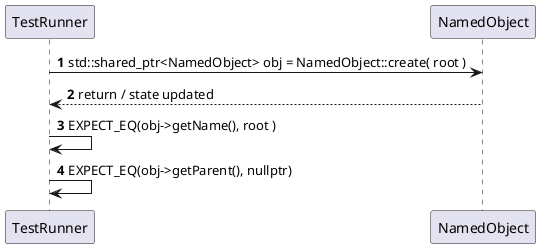

# Test Case: `NamedObjectTest.Creation`

| Property | Value |
| :--- | :--- |
| **Module** | `named` |
| **Source File** | `cmake-projects/named/test/TestNamedObject.cpp` (lines 12–26) |
| **Category** | Unit & Regression Verification |
| **Traceability** | See module specification (`FE-*` / `TSK-*`) |
| **Async Telemetry** | Standard GTest / CTest stdout |

## Summary

Executes verification scenario `NamedObjectTest.Creation` defined in `cmake-projects/named/test/TestNamedObject.cpp`.

## Sequence Diagram

## Observed Operations

- `std::shared_ptr<NamedObject> obj = NamedObject::create("root")`

## Verification Assertions

- `EXPECT_EQ(obj->getName(), "root")`
- `EXPECT_EQ(obj->getParent(), nullptr)`

---

[Back to `named` Tests Overview](../named.md)
