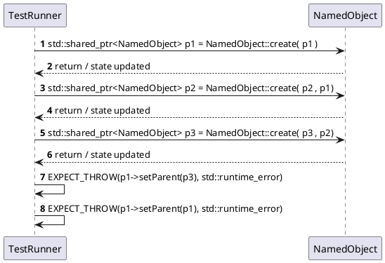

# Test Case: `NamedObjectTest.CycleDetection`

| Property | Value |
| :--- | :--- |
| **Module** | `named` |
| **Source File** | `cmake-projects/named/test/TestNamedObject.cpp` (lines 122–139) |
| **Category** | Unit & Regression Verification |
| **Traceability** | See module specification (`FE-*` / `TSK-*`) |
| **Async Telemetry** | Standard GTest / CTest stdout |

## Summary

Executes verification scenario `NamedObjectTest.CycleDetection` defined in `cmake-projects/named/test/TestNamedObject.cpp`.

## Sequence Diagram

## Observed Operations

- `std::shared_ptr<NamedObject> p1 = NamedObject::create("p1")`
- `std::shared_ptr<NamedObject> p2 = NamedObject::create("p2", p1)`
- `std::shared_ptr<NamedObject> p3 = NamedObject::create("p3", p2)`

## Verification Assertions

- `EXPECT_THROW(p1->setParent(p3), std::runtime_error)`
- `EXPECT_THROW(p1->setParent(p1), std::runtime_error)`

---

[Back to `named` Tests Overview](../named.md)
