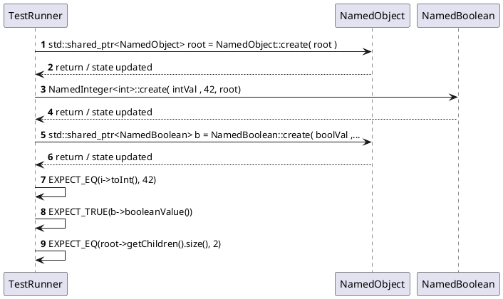

# Test Case: `NamedObjectTest.DerivedClasses`

| Property | Value |
| :--- | :--- |
| **Module** | `named` |
| **Source File** | `cmake-projects/named/test/TestNamedObject.cpp` (lines 141–161) |
| **Category** | Unit & Regression Verification |
| **Traceability** | See module specification (`FE-*` / `TSK-*`) |
| **Async Telemetry** | Standard GTest / CTest stdout |

## Summary

Executes verification scenario `NamedObjectTest.DerivedClasses` defined in `cmake-projects/named/test/TestNamedObject.cpp`.

## Sequence Diagram

## Observed Operations

- `std::shared_ptr<NamedObject> root = NamedObject::create("root")`
- `NamedInteger<int>::create("intVal", 42, root)`
- `std::shared_ptr<NamedBoolean> b = NamedBoolean::create("boolVal", true, root)`

## Verification Assertions

- `EXPECT_EQ(i->toInt(), 42)`
- `EXPECT_TRUE(b->booleanValue())`
- `EXPECT_EQ(root->getChildren().size(), 2)`

---

[Back to `named` Tests Overview](../named.md)
