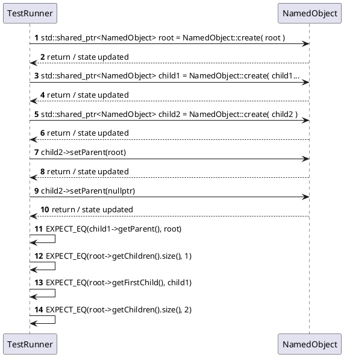

# Test Case: `NamedObjectTest.Hierarchy`

| Property | Value |
| :--- | :--- |
| **Module** | `named` |
| **Source File** | `cmake-projects/named/test/TestNamedObject.cpp` (lines 45–94) |
| **Category** | Unit & Regression Verification |
| **Traceability** | See module specification (`FE-*` / `TSK-*`) |
| **Async Telemetry** | Standard GTest / CTest stdout |

## Summary

Executes verification scenario `NamedObjectTest.Hierarchy` defined in `cmake-projects/named/test/TestNamedObject.cpp`.

## Sequence Diagram

## Observed Operations

- `std::shared_ptr<NamedObject> root = NamedObject::create("root")`
- `std::shared_ptr<NamedObject> child1 = NamedObject::create("child1", root)`
- `std::shared_ptr<NamedObject> child2 = NamedObject::create("child2")`
- `child2->setParent(root)`
- `child2->setParent(nullptr)`

## Verification Assertions

- `EXPECT_EQ(child1->getParent(), root)`
- `EXPECT_EQ(root->getChildren().size(), 1)`
- `EXPECT_EQ(root->getFirstChild(), child1)`
- `EXPECT_EQ(root->getChildren().size(), 2)`
- `EXPECT_EQ(child1->getNextSibling(), child2)`
- `EXPECT_EQ(child2->getPreviousSibling(), child1)`
- `EXPECT_EQ(root->getChildren().size(), 1)`
- `EXPECT_EQ(child2->getParent(), nullptr)`

---

[Back to `named` Tests Overview](../named.md)
