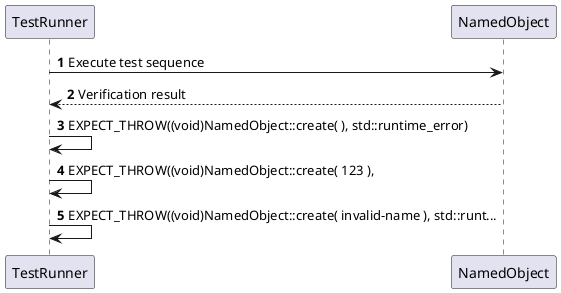

# Test Case: `NamedObjectTest.InvalidName`

| Property | Value |
| :--- | :--- |
| **Module** | `named` |
| **Source File** | `cmake-projects/named/test/TestNamedObject.cpp` (lines 28–43) |
| **Category** | Unit & Regression Verification |
| **Traceability** | See module specification (`FE-*` / `TSK-*`) |
| **Async Telemetry** | Standard GTest / CTest stdout |

## Summary

Executes verification scenario `NamedObjectTest.InvalidName` defined in `cmake-projects/named/test/TestNamedObject.cpp`.

## Sequence Diagram

## Observed Operations

- Invokes standalone executable entry flow.

## Verification Assertions

- `EXPECT_THROW((void)NamedObject::create(""), std::runtime_error)`
- `EXPECT_THROW((void)NamedObject::create("123"),`
- `EXPECT_THROW((void)NamedObject::create("invalid-name"), std::runtime_error)`

---

[Back to `named` Tests Overview](../named.md)
