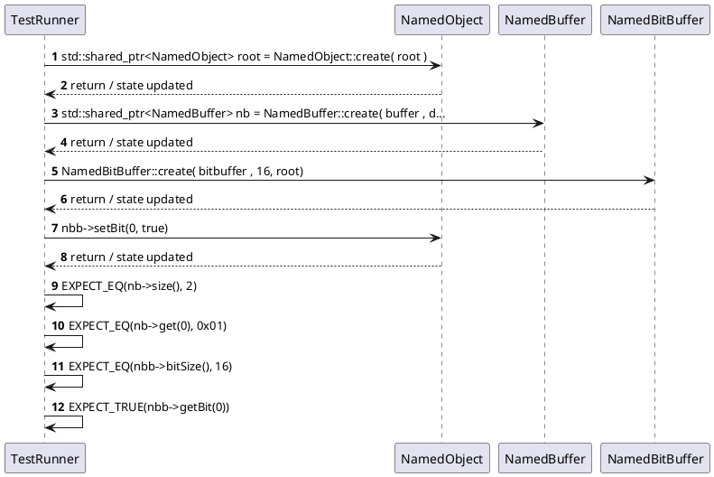

# Test Case: `NamedObjectTest.NamedBuffers`

| Property | Value |
| :--- | :--- |
| **Module** | `named` |
| **Source File** | `cmake-projects/named/test/TestNamedObject.cpp` (lines 207–232) |
| **Category** | Unit & Regression Verification |
| **Traceability** | See module specification (`FE-*` / `TSK-*`) |
| **Async Telemetry** | Standard GTest / CTest stdout |

## Summary

Executes verification scenario `NamedObjectTest.NamedBuffers` defined in `cmake-projects/named/test/TestNamedObject.cpp`.

## Sequence Diagram

## Observed Operations

- `std::shared_ptr<NamedObject> root = NamedObject::create("root")`
- `std::shared_ptr<NamedBuffer> nb = NamedBuffer::create("buffer", data, root)`
- `NamedBitBuffer::create("bitbuffer", 16, root)`
- `nbb->setBit(0, true)`

## Verification Assertions

- `EXPECT_EQ(nb->size(), 2)`
- `EXPECT_EQ(nb->get(0), 0x01)`
- `EXPECT_EQ(nbb->bitSize(), 16)`
- `EXPECT_TRUE(nbb->getBit(0))`

---

[Back to `named` Tests Overview](../named.md)
