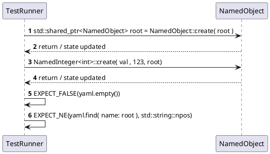

# Test Case: `NamedObjectTest.SerializationYAML`

| Property | Value |
| :--- | :--- |
| **Module** | `named` |
| **Source File** | `cmake-projects/named/test/TestNamedObject.cpp` (lines 186–205) |
| **Category** | Unit & Regression Verification |
| **Traceability** | See module specification (`FE-*` / `TSK-*`) |
| **Async Telemetry** | Standard GTest / CTest stdout |

## Summary

Executes verification scenario `NamedObjectTest.SerializationYAML` defined in `cmake-projects/named/test/TestNamedObject.cpp`.

## Sequence Diagram

## Observed Operations

- `std::shared_ptr<NamedObject> root = NamedObject::create("root")`
- `NamedInteger<int>::create("val", 123, root)`

## Verification Assertions

- `EXPECT_FALSE(yaml.empty())`
- `EXPECT_NE(yaml.find("name: root"), std::string::npos)`

---

[Back to `named` Tests Overview](../named.md)
