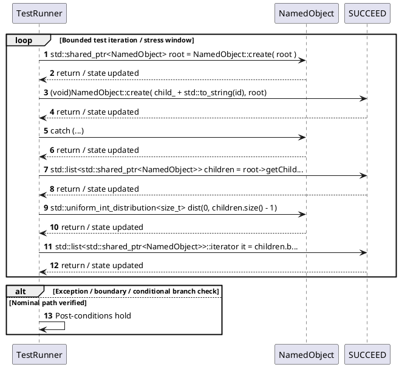

# Test Case: `NamedObjectThreadSafety.StressTest`

| Property | Value |
| :--- | :--- |
| **Module** | `named` |
| **Source File** | `cmake-projects/named/test/TestNamedObjectThreadSafety.cpp` (lines 19–120) |
| **Category** | Determinism, Fuzzing, Concurrency & Stress (`CS-0100.7`, `CS-0100.10`, `CS-0100.11`, `CS-0100.12`) |
| **Traceability** | See module specification (`FE-*` / `TSK-*`) |
| **Async Telemetry** | Standard GTest / CTest stdout |

## Summary

Stress test for concurrent NamedObject operations.

## Sequence Diagram

## Observed Operations

- `std::shared_ptr<NamedObject> root = NamedObject::create("root")`
- `(void)NamedObject::create("child_" + std::to_string(id), root)`
- `} catch (...) {`
- `std::list<std::shared_ptr<NamedObject>> children = root->getChildren()`
- `std::uniform_int_distribution<size_t> dist(0, children.size() - 1)`
- `std::list<std::shared_ptr<NamedObject>>::iterator it = children.begin()`
- `(*it)->setParent(nullptr); // Remove`
- `std::list<std::shared_ptr<NamedObject>> children = root->getChildren()`

## Verification Assertions

- Verified via exit status `0` and runtime checks inside executable.

---

[Back to `named` Tests Overview](../named.md)
