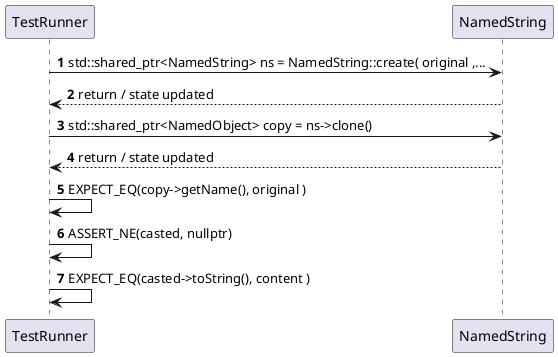

# Test Case: `NamedStringTest.Clone`

| Property | Value |
| :--- | :--- |
| **Module** | `named` |
| **Source File** | `cmake-projects/named/test/TestNamedString.cpp` (lines 47–70) |
| **Category** | Unit & Regression Verification |
| **Traceability** | See module specification (`FE-*` / `TSK-*`) |
| **Async Telemetry** | Standard GTest / CTest stdout |

## Summary

Executes verification scenario `NamedStringTest.Clone` defined in `cmake-projects/named/test/TestNamedString.cpp`.

## Sequence Diagram

## Observed Operations

- `std::shared_ptr<NamedString> ns = NamedString::create("original", "content")`
- `std::shared_ptr<NamedObject> copy = ns->clone()`

## Verification Assertions

- `EXPECT_EQ(copy->getName(), "original")`
- `ASSERT_NE(casted, nullptr)`
- `EXPECT_EQ(casted->toString(), "content")`

---

[Back to `named` Tests Overview](../named.md)
