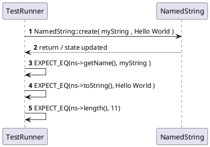

# Test Case: `NamedStringTest.CreationAndValue`

| Property | Value |
| :--- | :--- |
| **Module** | `named` |
| **Source File** | `cmake-projects/named/test/TestNamedString.cpp` (lines 7–27) |
| **Category** | Unit & Regression Verification |
| **Traceability** | See module specification (`FE-*` / `TSK-*`) |
| **Async Telemetry** | Standard GTest / CTest stdout |

## Summary

Executes verification scenario `NamedStringTest.CreationAndValue` defined in `cmake-projects/named/test/TestNamedString.cpp`.

## Sequence Diagram

## Observed Operations

- `NamedString::create("myString", "Hello World")`

## Verification Assertions

- `EXPECT_EQ(ns->getName(), "myString")`
- `EXPECT_EQ(ns->toString(), "Hello World")`
- `EXPECT_EQ(ns->length(), 11)`

---

[Back to `named` Tests Overview](../named.md)
