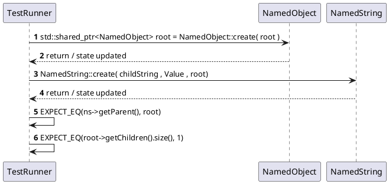

# Test Case: `NamedStringTest.ParentChild`

| Property | Value |
| :--- | :--- |
| **Module** | `named` |
| **Source File** | `cmake-projects/named/test/TestNamedString.cpp` (lines 29–45) |
| **Category** | Unit & Regression Verification |
| **Traceability** | See module specification (`FE-*` / `TSK-*`) |
| **Async Telemetry** | Standard GTest / CTest stdout |

## Summary

Executes verification scenario `NamedStringTest.ParentChild` defined in `cmake-projects/named/test/TestNamedString.cpp`.

## Sequence Diagram

## Observed Operations

- `std::shared_ptr<NamedObject> root = NamedObject::create("root")`
- `NamedString::create("childString", "Value", root)`

## Verification Assertions

- `EXPECT_EQ(ns->getParent(), root)`
- `EXPECT_EQ(root->getChildren().size(), 1)`

---

[Back to `named` Tests Overview](../named.md)
