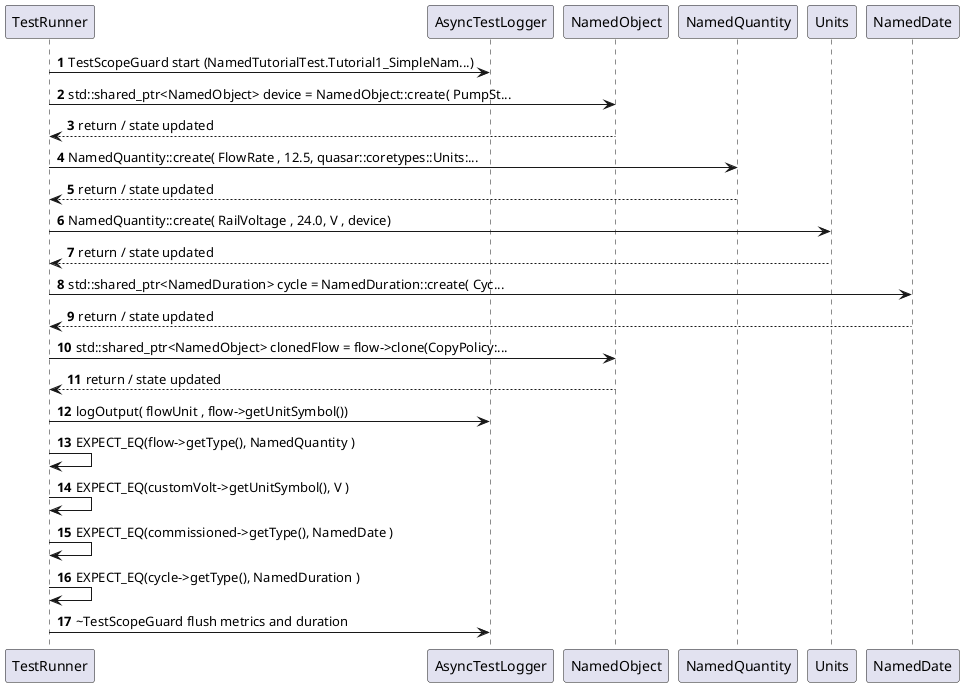

# Test Case: `NamedTutorialTest.Tutorial1_SimpleNamedPrimitivesAndQuantities`

| Property | Value |
| :--- | :--- |
| **Module** | `named` |
| **Source File** | `cmake-projects/named/test_cs0100/TestNamedExtended.cpp` (lines 83–104) |
| **Category** | Pedagogical Tutorial (`CS-0100.19`) |
| **Traceability** | `[TSK-20260328-001]`, `[TSK-20260311-001]`, `[FE-0260]`, `[FE-0150]` |
| **Async Telemetry** | Enabled (`TestScopeGuard` + `AsyncTestLogger`) |

## Summary

Extended CS-0100 test suite for `quasar_named` covering reflexive methods, web methods, traversal rules, CopyPolicy, and temporal/quantity/variant nodes.

## Sequence Diagram

## Observed Operations

- `std::shared_ptr<NamedObject> device = NamedObject::create("PumpStation")`
- `NamedQuantity::create("FlowRate", 12.5, quasar::coretypes::Units::Meter, device)`
- `NamedQuantity::create("RailVoltage", 24.0, "V", device)`
- `std::shared_ptr<NamedDuration> cycle = NamedDuration::create("CycleUs", 10000, device)`
- `std::shared_ptr<NamedObject> clonedFlow = flow->clone(CopyPolicy::DUPLICATE)`
- `logOutput("flowUnit", flow->getUnitSymbol())`

## Verification Assertions

- `EXPECT_EQ(flow->getType(), "NamedQuantity")`
- `EXPECT_EQ(customVolt->getUnitSymbol(), "V")`
- `EXPECT_EQ(commissioned->getType(), "NamedDate")`
- `EXPECT_EQ(cycle->getType(), "NamedDuration")`
- `EXPECT_EQ(boot->getType(), "NamedTimestamp")`
- `EXPECT_EQ(clonedFlow->getName(), "FlowRate")`

---

[Back to `named` Tests Overview](../named.md)
