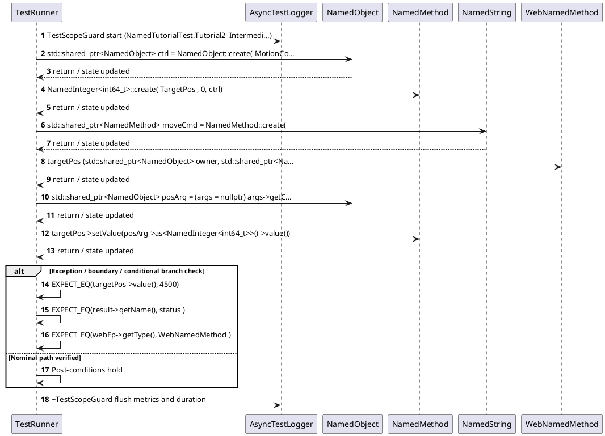

# Test Case: `NamedTutorialTest.Tutorial2_IntermediateReflexiveAndWebNamedMethod`

| Property | Value |
| :--- | :--- |
| **Module** | `named` |
| **Source File** | `cmake-projects/named/test_cs0100/TestNamedExtended.cpp` (lines 106–163) |
| **Category** | Pedagogical Tutorial (`CS-0100.19`) |
| **Traceability** | `[TSK-20260328-001]`, `[TSK-20260311-001]`, `[FE-0260]`, `[FE-0150]` |
| **Async Telemetry** | Enabled (`TestScopeGuard` + `AsyncTestLogger`) |

## Summary

Extended CS-0100 test suite for `quasar_named` covering reflexive methods, web methods, traversal rules, CopyPolicy, and temporal/quantity/variant nodes.

## Sequence Diagram

## Observed Operations

- `std::shared_ptr<NamedObject> ctrl = NamedObject::create("MotionController")`
- `NamedInteger<int64_t>::create("TargetPos", 0, ctrl)`
- `std::shared_ptr<NamedMethod> moveCmd = NamedMethod::create(`
- `[targetPos](std::shared_ptr<NamedObject> owner, std::shared_ptr<NamedObject> args) -> std::shared_ptr<NamedObject> {`
- `std::shared_ptr<NamedObject> posArg = (args != nullptr) ? args->getChild("pos") : nullptr`
- `targetPos->setValue(posArg->as<NamedInteger<int64_t>>()->value())`
- `targetPos->setValue(0)`
- `return NamedString::create("status", "OK")`

## Verification Assertions

- `EXPECT_EQ(targetPos->value(), 4500)`
- `EXPECT_EQ(result->getName(), "status")`
- `EXPECT_EQ(webEp->getType(), "WebNamedMethod")`
- `EXPECT_EQ(webEp->getHttpVerb(), "PUT")`
- `EXPECT_EQ(webEp->getAlias(), "/api/v1/move")`
- `EXPECT_EQ(webEp->getOasSummary(), "Commands axis motion")`
- `EXPECT_EQ(webEp->getHttpVerb(), "POST")`
- `EXPECT_EQ(webEp->getAlias(), "/api/v2/move")`
- `EXPECT_EQ(webEp->getOasSummary(), "Updated motion command")`

---

[Back to `named` Tests Overview](../named.md)
