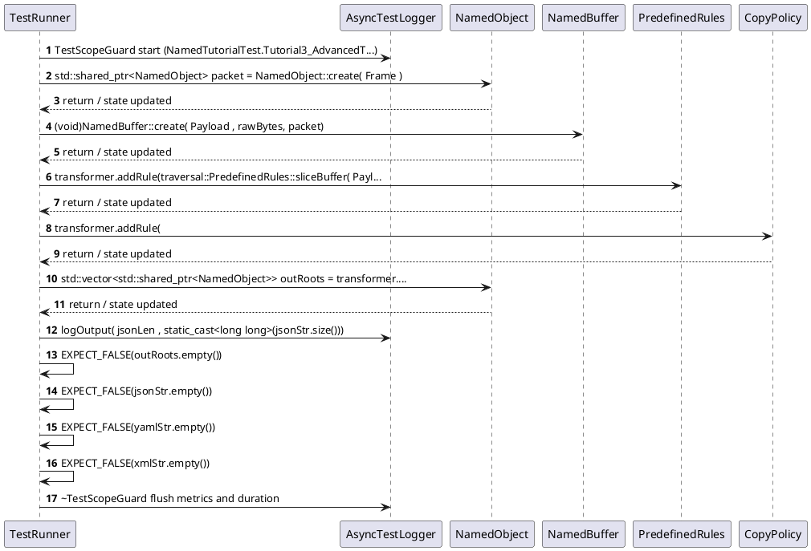

# Test Case: `NamedTutorialTest.Tutorial3_AdvancedTreeTransformationAndSerialization`

| Property | Value |
| :--- | :--- |
| **Module** | `named` |
| **Source File** | `cmake-projects/named/test_cs0100/TestNamedExtended.cpp` (lines 165–194) |
| **Category** | Pedagogical Tutorial (`CS-0100.19`) |
| **Traceability** | `[TSK-20260328-001]`, `[TSK-20260311-001]`, `[FE-0260]`, `[FE-0150]` |
| **Async Telemetry** | Enabled (`TestScopeGuard` + `AsyncTestLogger`) |

## Summary

Extended CS-0100 test suite for `quasar_named` covering reflexive methods, web methods, traversal rules, CopyPolicy, and temporal/quantity/variant nodes.

## Sequence Diagram

## Observed Operations

- `std::shared_ptr<NamedObject> packet = NamedObject::create("Frame")`
- `(void)NamedBuffer::create("Payload", rawBytes, packet)`
- `transformer.addRule(traversal::PredefinedRules::sliceBuffer("Payload", slices, CopyPolicy::SHARE, 10))`
- `transformer.addRule(`
- `std::vector<std::shared_ptr<NamedObject>> outRoots = transformer.transform(packet)`
- `logOutput("jsonLen", static_cast<long long>(jsonStr.size()))`

## Verification Assertions

- `EXPECT_FALSE(outRoots.empty())`
- `EXPECT_FALSE(jsonStr.empty())`
- `EXPECT_FALSE(yamlStr.empty())`
- `EXPECT_FALSE(xmlStr.empty())`

---

[Back to `named` Tests Overview](../named.md)
