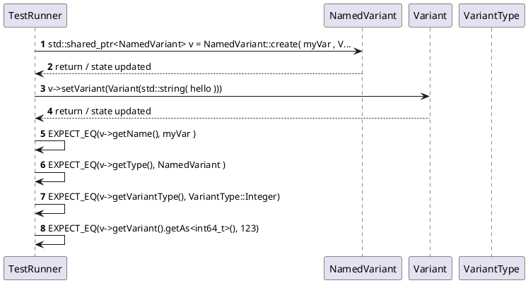

# Test Case: `NamedVariantTest.BasicUsage`

| Property | Value |
| :--- | :--- |
| **Module** | `named` |
| **Source File** | `cmake-projects/named/test/TestNamedVariant.cpp` (lines 13–26) |
| **Category** | Unit & Regression Verification |
| **Traceability** | See module specification (`FE-*` / `TSK-*`) |
| **Async Telemetry** | Standard GTest / CTest stdout |

## Summary

Verifies that NamedVariant correctly holds and allows updating its internal variant value.

## Sequence Diagram

## Observed Operations

- `std::shared_ptr<NamedVariant> v = NamedVariant::create("myVar", Variant(int64_t(123)))`
- `v->setVariant(Variant(std::string("hello")))`

## Verification Assertions

- `EXPECT_EQ(v->getName(), "myVar")`
- `EXPECT_EQ(v->getType(), "NamedVariant")`
- `EXPECT_EQ(v->getVariantType(), VariantType::Integer)`
- `EXPECT_EQ(v->getVariant().getAs<int64_t>(), 123)`
- `EXPECT_EQ(v->getVariant().getAs<std::string>(), "hello")`

---

[Back to `named` Tests Overview](../named.md)
