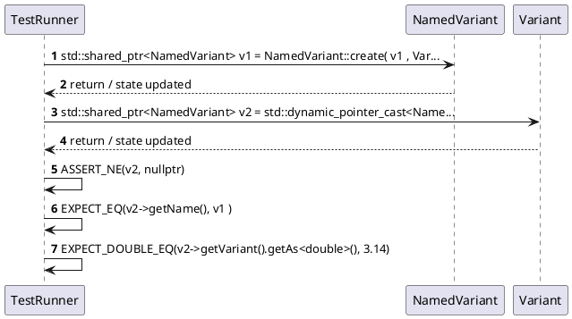

# Test Case: `NamedVariantTest.Cloning`

| Property | Value |
| :--- | :--- |
| **Module** | `named` |
| **Source File** | `cmake-projects/named/test/TestNamedVariant.cpp` (lines 32–42) |
| **Category** | Unit & Regression Verification |
| **Traceability** | See module specification (`FE-*` / `TSK-*`) |
| **Async Telemetry** | Standard GTest / CTest stdout |

## Summary

Verifies that NamedVariant correctly implements the clone operation.

## Sequence Diagram

## Observed Operations

- `std::shared_ptr<NamedVariant> v1 = NamedVariant::create("v1", Variant(3.14))`
- `std::shared_ptr<NamedVariant> v2 = std::dynamic_pointer_cast<NamedVariant>(v1->clone())`

## Verification Assertions

- `ASSERT_NE(v2, nullptr)`
- `EXPECT_EQ(v2->getName(), "v1")`
- `EXPECT_DOUBLE_EQ(v2->getVariant().getAs<double>(), 3.14)`

---

[Back to `named` Tests Overview](../named.md)
