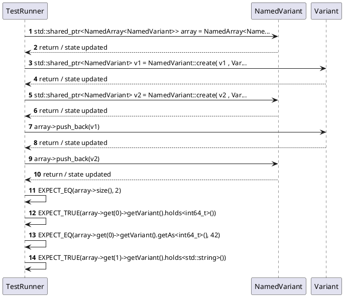

# Test Case: `NamedVariantsAndTemporalTest.CollectionVariants`

| Property | Value |
| :--- | :--- |
| **Module** | `named` |
| **Source File** | `cmake-projects/named/test/TestNamedVariantsAndTemporal.cpp` (lines 48–64) |
| **Category** | Unit & Regression Verification |
| **Traceability** | See module specification (`FE-*` / `TSK-*`) |
| **Async Telemetry** | Standard GTest / CTest stdout |

## Summary

Verifies that NamedVariants can be stored in named collections.

## Sequence Diagram

## Observed Operations

- `std::shared_ptr<NamedArray<NamedVariant>> array = NamedArray<NamedVariant>::create("varArray")`
- `std::shared_ptr<NamedVariant> v1 = NamedVariant::create("v1", Variant(static_cast<int64_t>(42)))`
- `std::shared_ptr<NamedVariant> v2 = NamedVariant::create("v2", Variant(std::string("world")))`
- `array->push_back(v1)`
- `array->push_back(v2)`

## Verification Assertions

- `EXPECT_EQ(array->size(), 2)`
- `EXPECT_TRUE(array->get(0)->getVariant().holds<int64_t>())`
- `EXPECT_EQ(array->get(0)->getVariant().getAs<int64_t>(), 42)`
- `EXPECT_TRUE(array->get(1)->getVariant().holds<std::string>())`
- `EXPECT_EQ(array->get(1)->getVariant().getAs<std::string>(), "world")`

---

[Back to `named` Tests Overview](../named.md)
