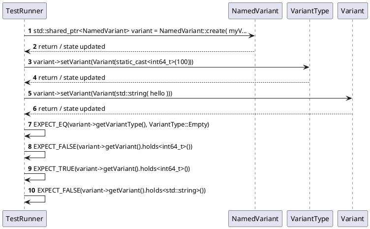

# Test Case: `NamedVariantsAndTemporalTest.NamedVariant`

| Property | Value |
| :--- | :--- |
| **Module** | `named` |
| **Source File** | `cmake-projects/named/test/TestNamedVariantsAndTemporal.cpp` (lines 17–39) |
| **Category** | Unit & Regression Verification |
| **Traceability** | See module specification (`FE-*` / `TSK-*`) |
| **Async Telemetry** | Standard GTest / CTest stdout |

## Summary

Verifies the basic functionality of the new value-based NamedVariant.

## Sequence Diagram

## Observed Operations

- `std::shared_ptr<NamedVariant> variant = NamedVariant::create("myVariant")`
- `variant->setVariant(Variant(static_cast<int64_t>(100)))`
- `variant->setVariant(Variant(std::string("hello")))`

## Verification Assertions

- `EXPECT_EQ(variant->getVariantType(), VariantType::Empty)`
- `EXPECT_FALSE(variant->getVariant().holds<int64_t>())`
- `EXPECT_TRUE(variant->getVariant().holds<int64_t>())`
- `EXPECT_FALSE(variant->getVariant().holds<std::string>())`
- `EXPECT_EQ(variant->getVariant().getAs<int64_t>(), 100)`
- `EXPECT_FALSE(variant->getVariant().holds<int64_t>())`
- `EXPECT_TRUE(variant->getVariant().holds<std::string>())`
- `EXPECT_EQ(variant->getVariant().getAs<std::string>(), "hello")`

---

[Back to `named` Tests Overview](../named.md)
