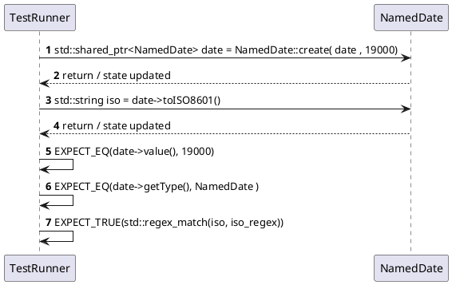

# Test Case: `NamedVariantsAndTemporalTest.TemporalDateTest`

| Property | Value |
| :--- | :--- |
| **Module** | `named` |
| **Source File** | `cmake-projects/named/test/TestNamedVariantsAndTemporal.cpp` (lines 103–113) |
| **Category** | Unit & Regression Verification |
| **Traceability** | See module specification (`FE-*` / `TSK-*`) |
| **Async Telemetry** | Standard GTest / CTest stdout |

## Summary

Verifies the functionality of the NamedDate class.

## Sequence Diagram

## Observed Operations

- `std::shared_ptr<NamedDate> date = NamedDate::create("date", 19000)`
- `std::string iso = date->toISO8601()`

## Verification Assertions

- `EXPECT_EQ(date->value(), 19000)`
- `EXPECT_EQ(date->getType(), "NamedDate")`
- `EXPECT_TRUE(std::regex_match(iso, iso_regex))`

---

[Back to `named` Tests Overview](../named.md)
