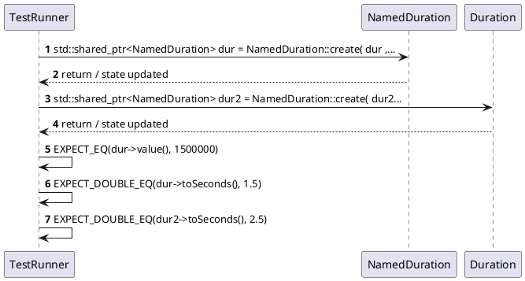

# Test Case: `NamedVariantsAndTemporalTest.TemporalDurationTest`

| Property | Value |
| :--- | :--- |
| **Module** | `named` |
| **Source File** | `cmake-projects/named/test/TestNamedVariantsAndTemporal.cpp` (lines 89–97) |
| **Category** | Unit & Regression Verification |
| **Traceability** | See module specification (`FE-*` / `TSK-*`) |
| **Async Telemetry** | Standard GTest / CTest stdout |

## Summary

Verifies the functionality of the NamedDuration class.

## Sequence Diagram

## Observed Operations

- `std::shared_ptr<NamedDuration> dur = NamedDuration::create("dur", 1500000); // 1.5 seconds`
- `std::shared_ptr<NamedDuration> dur2 = NamedDuration::create("dur2", Duration::fromSeconds(2.5).value())`

## Verification Assertions

- `EXPECT_EQ(dur->value(), 1500000)`
- `EXPECT_DOUBLE_EQ(dur->toSeconds(), 1.5)`
- `EXPECT_DOUBLE_EQ(dur2->toSeconds(), 2.5)`

---

[Back to `named` Tests Overview](../named.md)
