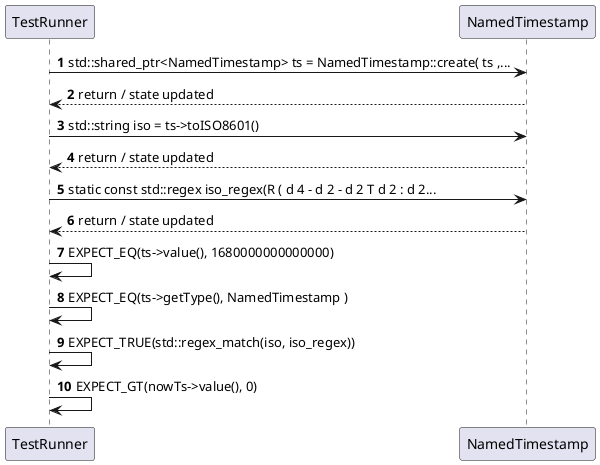

# Test Case: `NamedVariantsAndTemporalTest.TemporalTimestampTest`

| Property | Value |
| :--- | :--- |
| **Module** | `named` |
| **Source File** | `cmake-projects/named/test/TestNamedVariantsAndTemporal.cpp` (lines 70–83) |
| **Category** | Unit & Regression Verification |
| **Traceability** | See module specification (`FE-*` / `TSK-*`) |
| **Async Telemetry** | Standard GTest / CTest stdout |

## Summary

Verifies the functionality of the NamedTimestamp class.

## Sequence Diagram

## Observed Operations

- `std::shared_ptr<NamedTimestamp> ts = NamedTimestamp::create("ts", 1680000000000000)`
- `std::string iso = ts->toISO8601()`
- `static const std::regex iso_regex(R"(\d{4}-\d{2}-\d{2}T\d{2}:\d{2}:\d{2}\.\d{6}Z)")`

## Verification Assertions

- `EXPECT_EQ(ts->value(), 1680000000000000)`
- `EXPECT_EQ(ts->getType(), "NamedTimestamp")`
- `EXPECT_TRUE(std::regex_match(iso, iso_regex))`
- `EXPECT_GT(nowTs->value(), 0)`

---

[Back to `named` Tests Overview](../named.md)
