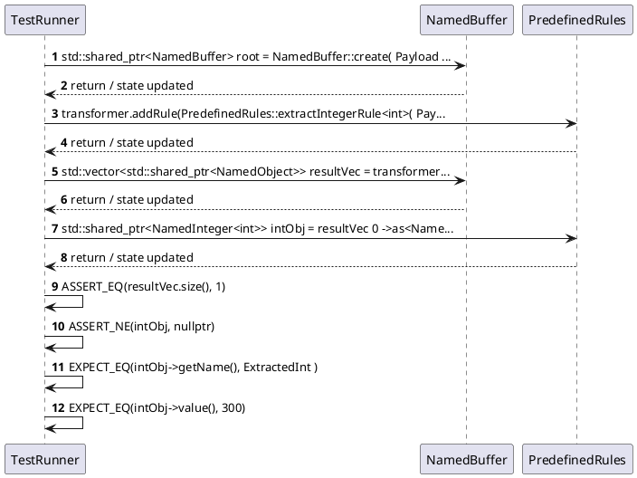

# Test Case: `PredefinedRulesTest.ExtractIntegerRule`

| Property | Value |
| :--- | :--- |
| **Module** | `named` |
| **Source File** | `cmake-projects/named/test/TestPredefinedRules.cpp` (lines 48–62) |
| **Category** | Unit & Regression Verification |
| **Traceability** | See module specification (`FE-*` / `TSK-*`) |
| **Async Telemetry** | Standard GTest / CTest stdout |

## Summary

Executes verification scenario `PredefinedRulesTest.ExtractIntegerRule` defined in `cmake-projects/named/test/TestPredefinedRules.cpp`.

## Sequence Diagram

## Observed Operations

- `std::shared_ptr<NamedBuffer> root = NamedBuffer::create("Payload", data)`
- `transformer.addRule(PredefinedRules::extractIntegerRule<int>("Payload", "ExtractedInt", 0))`
- `std::vector<std::shared_ptr<NamedObject>> resultVec = transformer.transform(root)`
- `std::shared_ptr<NamedInteger<int>> intObj = resultVec[0]->as<NamedInteger<int>>()`

## Verification Assertions

- `ASSERT_EQ(resultVec.size(), 1)`
- `ASSERT_NE(intObj, nullptr)`
- `EXPECT_EQ(intObj->getName(), "ExtractedInt")`
- `EXPECT_EQ(intObj->value(), 300)`

---

[Back to `named` Tests Overview](../named.md)
