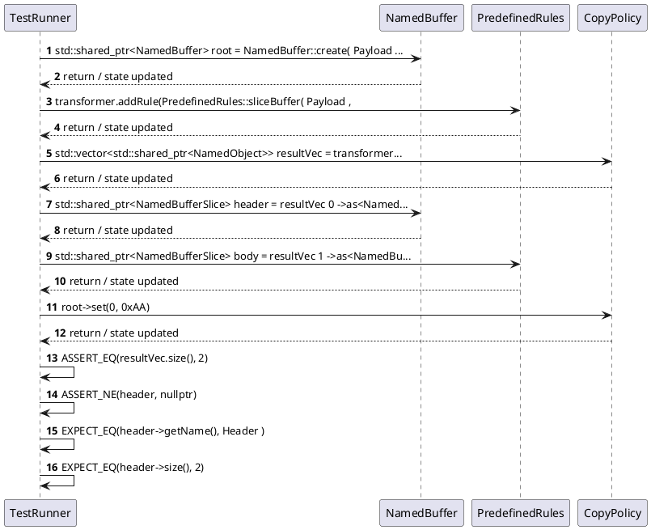

# Test Case: `PredefinedRulesTest.SliceBufferRuleShare`

| Property | Value |
| :--- | :--- |
| **Module** | `named` |
| **Source File** | `cmake-projects/named/test/TestPredefinedRules.cpp` (lines 17–46) |
| **Category** | Unit & Regression Verification |
| **Traceability** | See module specification (`FE-*` / `TSK-*`) |
| **Async Telemetry** | Standard GTest / CTest stdout |

## Summary

Executes verification scenario `PredefinedRulesTest.SliceBufferRuleShare` defined in `cmake-projects/named/test/TestPredefinedRules.cpp`.

## Sequence Diagram

## Observed Operations

- `std::shared_ptr<NamedBuffer> root = NamedBuffer::create("Payload", data)`
- `transformer.addRule(PredefinedRules::sliceBuffer("Payload", {`
- `std::vector<std::shared_ptr<NamedObject>> resultVec = transformer.transform(root)`
- `std::shared_ptr<NamedBufferSlice> header = resultVec[0]->as<NamedBufferSlice>()`
- `std::shared_ptr<NamedBufferSlice> body = resultVec[1]->as<NamedBufferSlice>()`
- `root->set(0, 0xAA)`

## Verification Assertions

- `ASSERT_EQ(resultVec.size(), 2)`
- `ASSERT_NE(header, nullptr)`
- `EXPECT_EQ(header->getName(), "Header")`
- `EXPECT_EQ(header->size(), 2)`
- `EXPECT_EQ(header->get(0), 0x11)`
- `EXPECT_EQ(header->get(1), 0x22)`
- `ASSERT_NE(body, nullptr)`
- `EXPECT_EQ(body->getName(), "Body")`
- `EXPECT_EQ(body->size(), 4)`
- `EXPECT_EQ(body->get(0), 0x33)`

---

[Back to `named` Tests Overview](../named.md)
