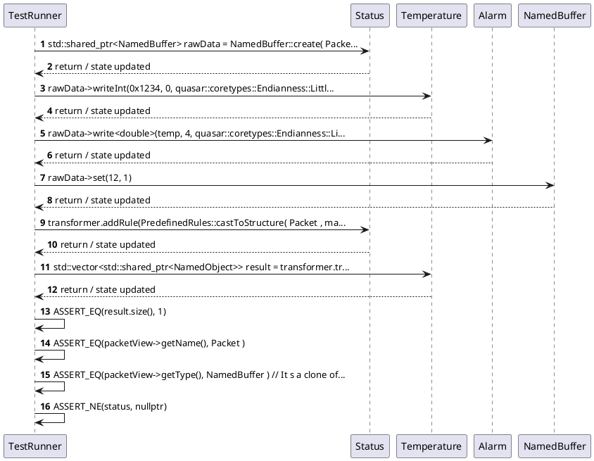

# Test Case: `ProtocolMappingTest.CastToStructureZeroCopy`

| Property | Value |
| :--- | :--- |
| **Module** | `named` |
| **Source File** | `cmake-projects/named/test/TestProtocolMapping.cpp` (lines 19–68) |
| **Category** | Unit & Regression Verification |
| **Traceability** | See module specification (`FE-*` / `TSK-*`) |
| **Async Telemetry** | Standard GTest / CTest stdout |

## Summary

Executes verification scenario `ProtocolMappingTest.CastToStructureZeroCopy` defined in `cmake-projects/named/test/TestProtocolMapping.cpp`.

## Sequence Diagram

## Observed Operations

- `std::shared_ptr<NamedBuffer> rawData = NamedBuffer::create("Packet", 16)`
- `rawData->writeInt(0x1234, 0, quasar::coretypes::Endianness::LittleEndian)`
- `rawData->write<double>(temp, 4, quasar::coretypes::Endianness::LittleEndian)`
- `rawData->set(12, 1)`
- `transformer.addRule(PredefinedRules::castToStructure("Packet", mappings))`
- `std::vector<std::shared_ptr<NamedObject>> result = transformer.transform(rawData)`
- `std::shared_ptr<NamedInteger<int32_t>> status = std::dynamic_pointer_cast<NamedInteger<int32_t>>(packetView->getChild("Status"))`
- `std::shared_ptr<NamedFloatingPoint<double>> temperature = std::dynamic_pointer_cast<NamedFloatingPoint<double>>(packetView->getChild("Temperature"))`

## Verification Assertions

- `ASSERT_EQ(result.size(), 1)`
- `ASSERT_EQ(packetView->getName(), "Packet")`
- `ASSERT_EQ(packetView->getType(), "NamedBuffer"); // It's a clone of the buffer`
- `ASSERT_NE(status, nullptr)`
- `ASSERT_NE(temperature, nullptr)`
- `ASSERT_NE(alarm, nullptr)`
- `ASSERT_EQ(status->value(), 0x1234)`
- `ASSERT_DOUBLE_EQ(temperature->value(), 36.6)`
- `ASSERT_TRUE(alarm->booleanValue())`
- `ASSERT_EQ(status->value(), 0x5678)`

---

[Back to `named` Tests Overview](../named.md)
