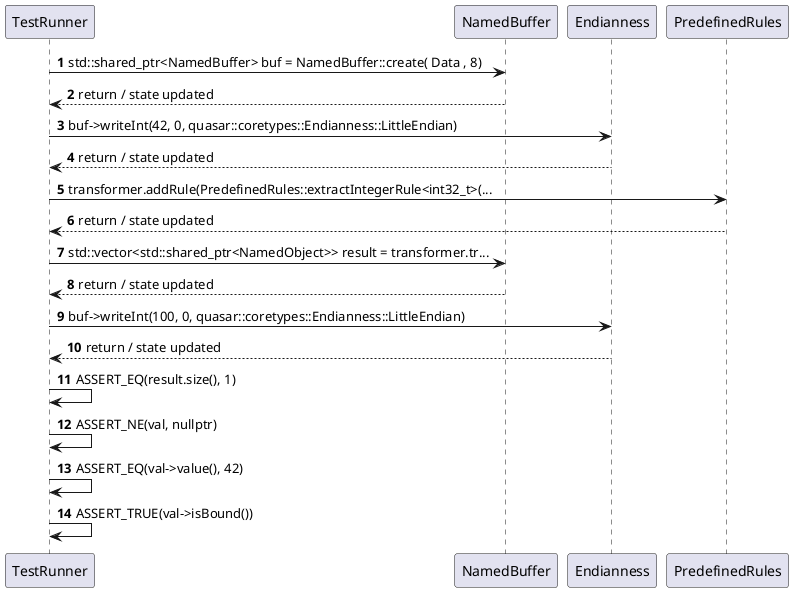

# Test Case: `ProtocolMappingTest.ExtractIntegerZeroCopy`

| Property | Value |
| :--- | :--- |
| **Module** | `named` |
| **Source File** | `cmake-projects/named/test/TestProtocolMapping.cpp` (lines 70–88) |
| **Category** | Unit & Regression Verification |
| **Traceability** | See module specification (`FE-*` / `TSK-*`) |
| **Async Telemetry** | Standard GTest / CTest stdout |

## Summary

Executes verification scenario `ProtocolMappingTest.ExtractIntegerZeroCopy` defined in `cmake-projects/named/test/TestProtocolMapping.cpp`.

## Sequence Diagram

## Observed Operations

- `std::shared_ptr<NamedBuffer> buf = NamedBuffer::create("Data", 8)`
- `buf->writeInt(42, 0, quasar::coretypes::Endianness::LittleEndian)`
- `transformer.addRule(PredefinedRules::extractIntegerRule<int32_t>("Data", "Value", 0, quasar::coretypes::Endianness::LittleEndian))`
- `std::vector<std::shared_ptr<NamedObject>> result = transformer.transform(buf)`
- `buf->writeInt(100, 0, quasar::coretypes::Endianness::LittleEndian)`

## Verification Assertions

- `ASSERT_EQ(result.size(), 1)`
- `ASSERT_NE(val, nullptr)`
- `ASSERT_EQ(val->value(), 42)`
- `ASSERT_TRUE(val->isBound())`
- `ASSERT_EQ(val->value(), 100)`

---

[Back to `named` Tests Overview](../named.md)
