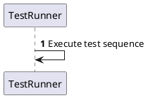

# Test Case: `SerializationTest.JSONRoundTrip`

| Property | Value |
| :--- | :--- |
| **Module** | `named` |
| **Source File** | `cmake-projects/named/test/TestSerialization.cpp` (lines 218–226) |
| **Category** | Unit & Regression Verification |
| **Traceability** | See module specification (`FE-*` / `TSK-*`) |
| **Async Telemetry** | Standard GTest / CTest stdout |

## Summary

Executes verification scenario `SerializationTest.JSONRoundTrip` defined in `cmake-projects/named/test/TestSerialization.cpp`.

## Sequence Diagram

## Observed Operations

- Invokes standalone executable entry flow.

## Verification Assertions

- Verified via exit status `0` and runtime checks inside executable.

---

[Back to `named` Tests Overview](../named.md)
