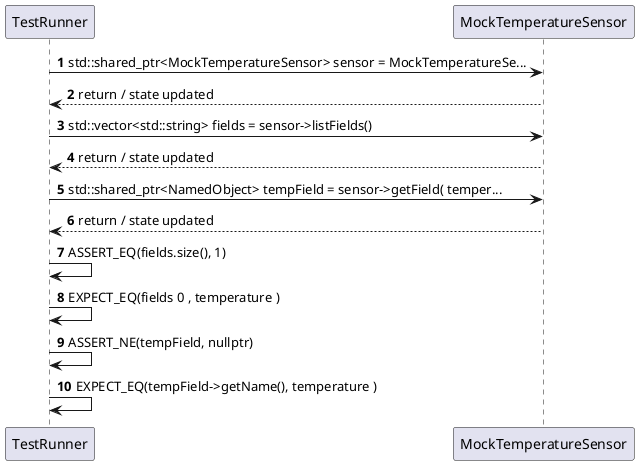

# Test Case: `TestActiveEntity.FieldReflexivity`

| Property | Value |
| :--- | :--- |
| **Module** | `named` |
| **Source File** | `cmake-projects/named/test/TestActiveEntity.cpp` (lines 192–206) |
| **Category** | Unit & Regression Verification |
| **Traceability** | See module specification (`FE-*` / `TSK-*`) |
| **Async Telemetry** | Standard GTest / CTest stdout |

## Summary

A simple mock for event data.

## Sequence Diagram

## Observed Operations

- `std::shared_ptr<MockTemperatureSensor> sensor = MockTemperatureSensor::create("sensor1")`
- `std::vector<std::string> fields = sensor->listFields()`
- `std::shared_ptr<NamedObject> tempField = sensor->getField("temperature")`

## Verification Assertions

- `ASSERT_EQ(fields.size(), 1)`
- `EXPECT_EQ(fields[0], "temperature")`
- `ASSERT_NE(tempField, nullptr)`
- `EXPECT_EQ(tempField->getName(), "temperature")`
- `EXPECT_EQ(tempField, sensor->getTemperatureNode())`
- `EXPECT_EQ(sensor->getField("nonExistent"), nullptr)`

---

[Back to `named` Tests Overview](../named.md)
