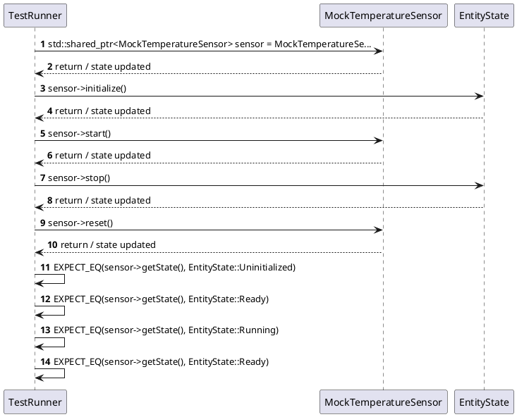

# Test Case: `TestActiveEntity.LifecycleTransitions`

| Property | Value |
| :--- | :--- |
| **Module** | `named` |
| **Source File** | `cmake-projects/named/test/TestActiveEntity.cpp` (lines 151–168) |
| **Category** | Unit & Regression Verification |
| **Traceability** | See module specification (`FE-*` / `TSK-*`) |
| **Async Telemetry** | Standard GTest / CTest stdout |

## Summary

A simple mock for event data.

## Sequence Diagram

## Observed Operations

- `std::shared_ptr<MockTemperatureSensor> sensor = MockTemperatureSensor::create("sensor1")`
- `sensor->initialize()`
- `sensor->start()`
- `sensor->stop()`
- `sensor->reset()`

## Verification Assertions

- `EXPECT_EQ(sensor->getState(), EntityState::Uninitialized)`
- `EXPECT_EQ(sensor->getState(), EntityState::Ready)`
- `EXPECT_EQ(sensor->getState(), EntityState::Running)`
- `EXPECT_EQ(sensor->getState(), EntityState::Ready)`
- `EXPECT_EQ(sensor->getState(), EntityState::Uninitialized)`

---

[Back to `named` Tests Overview](../named.md)
