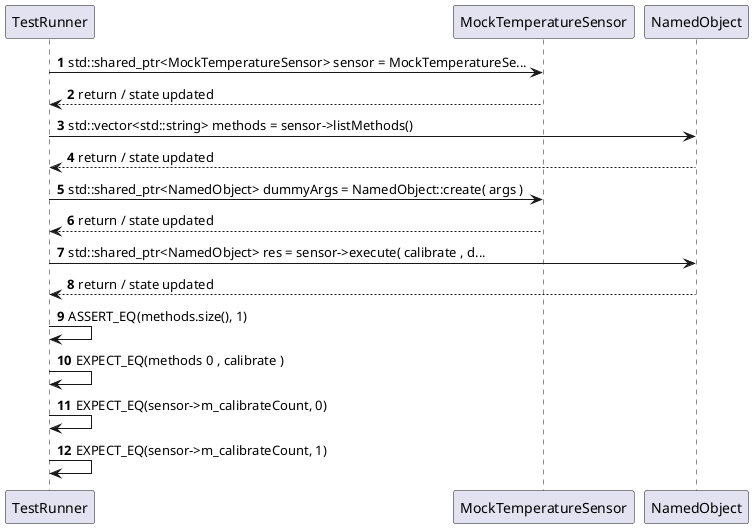

# Test Case: `TestActiveEntity.MethodReflexivity`

| Property | Value |
| :--- | :--- |
| **Module** | `named` |
| **Source File** | `cmake-projects/named/test/TestActiveEntity.cpp` (lines 208–229) |
| **Category** | Unit & Regression Verification |
| **Traceability** | See module specification (`FE-*` / `TSK-*`) |
| **Async Telemetry** | Standard GTest / CTest stdout |

## Summary

A simple mock for event data.

## Sequence Diagram

## Observed Operations

- `std::shared_ptr<MockTemperatureSensor> sensor = MockTemperatureSensor::create("sensor1")`
- `std::vector<std::string> methods = sensor->listMethods()`
- `std::shared_ptr<NamedObject> dummyArgs = NamedObject::create("args")`
- `std::shared_ptr<NamedObject> res = sensor->execute("calibrate", dummyArgs)`

## Verification Assertions

- `ASSERT_EQ(methods.size(), 1)`
- `EXPECT_EQ(methods[0], "calibrate")`
- `EXPECT_EQ(sensor->m_calibrateCount, 0)`
- `EXPECT_EQ(sensor->m_calibrateCount, 1)`
- `ASSERT_NE(res, nullptr)`
- `EXPECT_EQ(res->getName(), "calibrationResult")`
- `EXPECT_THROW(sensor->execute("unknownMethod", dummyArgs), std::runtime_error)`

---

[Back to `named` Tests Overview](../named.md)
