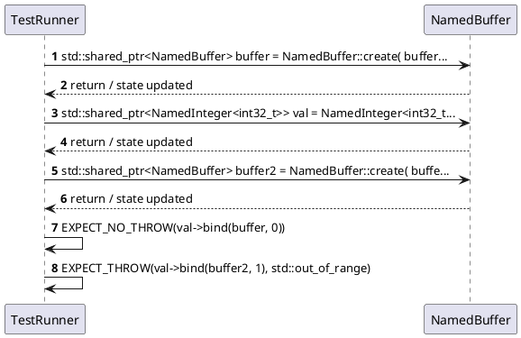

# Test Case: `TestBoundPrimitives.BoundaryCheck`

| Property | Value |
| :--- | :--- |
| **Module** | `named` |
| **Source File** | `cmake-projects/named/test/TestBoundPrimitives.cpp` (lines 71–81) |
| **Category** | Coverage, Enum, Boundary & Exception Containment (`CS-0100.1`, `CS-0100.3`, `CS-0100.4`, `CS-0100.6`, `CS-0100.9`) |
| **Traceability** | See module specification (`FE-*` / `TSK-*`) |
| **Async Telemetry** | Standard GTest / CTest stdout |

## Summary

Executes verification scenario `TestBoundPrimitives.BoundaryCheck` defined in `cmake-projects/named/test/TestBoundPrimitives.cpp`.

## Sequence Diagram

## Observed Operations

- `std::shared_ptr<NamedBuffer> buffer = NamedBuffer::create("buffer", 4)`
- `std::shared_ptr<NamedInteger<int32_t>> val = NamedInteger<int32_t>::create("val", 0)`
- `std::shared_ptr<NamedBuffer> buffer2 = NamedBuffer::create("buffer2", 4)`

## Verification Assertions

- `EXPECT_NO_THROW(val->bind(buffer, 0))`
- `EXPECT_THROW(val->bind(buffer2, 1), std::out_of_range)`

---

[Back to `named` Tests Overview](../named.md)
