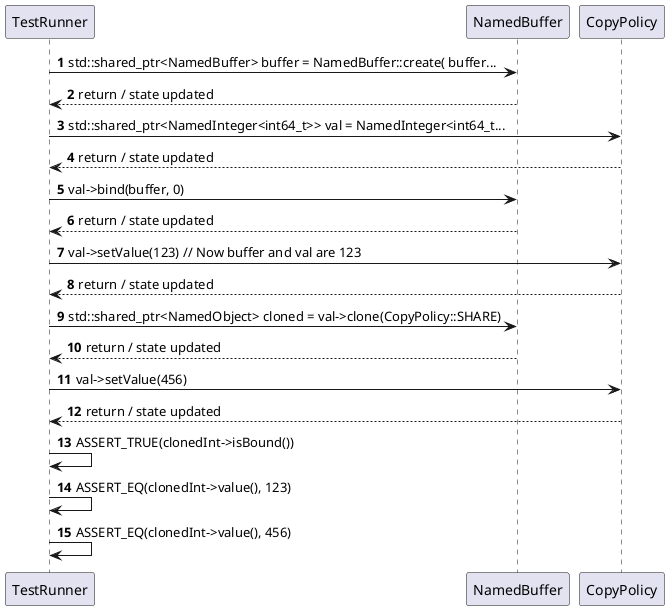

# Test Case: `TestBoundPrimitives.CloneSharingPolicy`

| Property | Value |
| :--- | :--- |
| **Module** | `named` |
| **Source File** | `cmake-projects/named/test/TestBoundPrimitives.cpp` (lines 83–99) |
| **Category** | Unit & Regression Verification |
| **Traceability** | See module specification (`FE-*` / `TSK-*`) |
| **Async Telemetry** | Standard GTest / CTest stdout |

## Summary

Executes verification scenario `TestBoundPrimitives.CloneSharingPolicy` defined in `cmake-projects/named/test/TestBoundPrimitives.cpp`.

## Sequence Diagram

## Observed Operations

- `std::shared_ptr<NamedBuffer> buffer = NamedBuffer::create("buffer", 8)`
- `std::shared_ptr<NamedInteger<int64_t>> val = NamedInteger<int64_t>::create("val", 0)`
- `val->bind(buffer, 0)`
- `val->setValue(123); // Now buffer and val are 123`
- `std::shared_ptr<NamedObject> cloned = val->clone(CopyPolicy::SHARE)`
- `val->setValue(456)`

## Verification Assertions

- `ASSERT_TRUE(clonedInt->isBound())`
- `ASSERT_EQ(clonedInt->value(), 123)`
- `ASSERT_EQ(clonedInt->value(), 456)`

---

[Back to `named` Tests Overview](../named.md)
