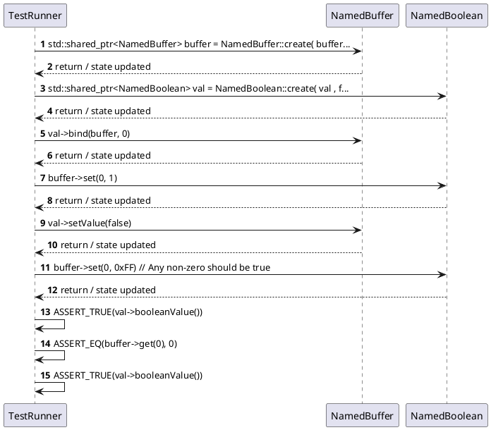

# Test Case: `TestBoundPrimitives.NamedBooleanBinding`

| Property | Value |
| :--- | :--- |
| **Module** | `named` |
| **Source File** | `cmake-projects/named/test/TestBoundPrimitives.cpp` (lines 55–69) |
| **Category** | Unit & Regression Verification |
| **Traceability** | See module specification (`FE-*` / `TSK-*`) |
| **Async Telemetry** | Standard GTest / CTest stdout |

## Summary

Executes verification scenario `TestBoundPrimitives.NamedBooleanBinding` defined in `cmake-projects/named/test/TestBoundPrimitives.cpp`.

## Sequence Diagram

## Observed Operations

- `std::shared_ptr<NamedBuffer> buffer = NamedBuffer::create("buffer", 16)`
- `std::shared_ptr<NamedBoolean> val = NamedBoolean::create("val", false)`
- `val->bind(buffer, 0)`
- `buffer->set(0, 1)`
- `val->setValue(false)`
- `buffer->set(0, 0xFF); // Any non-zero should be true`

## Verification Assertions

- `ASSERT_TRUE(val->booleanValue())`
- `ASSERT_EQ(buffer->get(0), 0)`
- `ASSERT_TRUE(val->booleanValue())`

---

[Back to `named` Tests Overview](../named.md)
