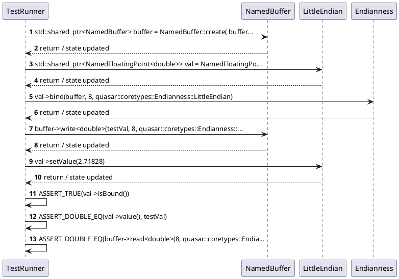

# Test Case: `TestBoundPrimitives.NamedFloatingPointBinding`

| Property | Value |
| :--- | :--- |
| **Module** | `named` |
| **Source File** | `cmake-projects/named/test/TestBoundPrimitives.cpp` (lines 37–53) |
| **Category** | Unit & Regression Verification |
| **Traceability** | See module specification (`FE-*` / `TSK-*`) |
| **Async Telemetry** | Standard GTest / CTest stdout |

## Summary

Executes verification scenario `TestBoundPrimitives.NamedFloatingPointBinding` defined in `cmake-projects/named/test/TestBoundPrimitives.cpp`.

## Sequence Diagram

## Observed Operations

- `std::shared_ptr<NamedBuffer> buffer = NamedBuffer::create("buffer", 16)`
- `std::shared_ptr<NamedFloatingPoint<double>> val = NamedFloatingPoint<double>::create("val", 0.0)`
- `val->bind(buffer, 8, quasar::coretypes::Endianness::LittleEndian)`
- `buffer->write<double>(testVal, 8, quasar::coretypes::Endianness::LittleEndian)`
- `val->setValue(2.71828)`

## Verification Assertions

- `ASSERT_TRUE(val->isBound())`
- `ASSERT_DOUBLE_EQ(val->value(), testVal)`
- `ASSERT_DOUBLE_EQ(buffer->read<double>(8, quasar::coretypes::Endianness::LittleEndian), 2.71828)`

---

[Back to `named` Tests Overview](../named.md)
