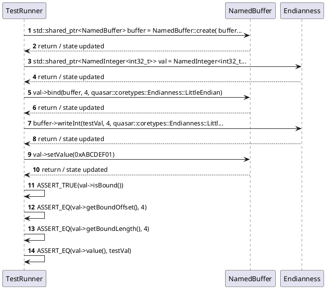

# Test Case: `TestBoundPrimitives.NamedIntegerBinding`

| Property | Value |
| :--- | :--- |
| **Module** | `named` |
| **Source File** | `cmake-projects/named/test/TestBoundPrimitives.cpp` (lines 16–35) |
| **Category** | Unit & Regression Verification |
| **Traceability** | See module specification (`FE-*` / `TSK-*`) |
| **Async Telemetry** | Standard GTest / CTest stdout |

## Summary

Executes verification scenario `TestBoundPrimitives.NamedIntegerBinding` defined in `cmake-projects/named/test/TestBoundPrimitives.cpp`.

## Sequence Diagram

## Observed Operations

- `std::shared_ptr<NamedBuffer> buffer = NamedBuffer::create("buffer", 16)`
- `std::shared_ptr<NamedInteger<int32_t>> val = NamedInteger<int32_t>::create("val", 0)`
- `val->bind(buffer, 4, quasar::coretypes::Endianness::LittleEndian)`
- `buffer->writeInt(testVal, 4, quasar::coretypes::Endianness::LittleEndian)`
- `val->setValue(0xABCDEF01)`

## Verification Assertions

- `ASSERT_TRUE(val->isBound())`
- `ASSERT_EQ(val->getBoundOffset(), 4)`
- `ASSERT_EQ(val->getBoundLength(), 4)`
- `ASSERT_EQ(val->value(), testVal)`
- `ASSERT_EQ(buffer->readInt(4, quasar::coretypes::Endianness::LittleEndian), 0xABCDEF01)`

---

[Back to `named` Tests Overview](../named.md)
