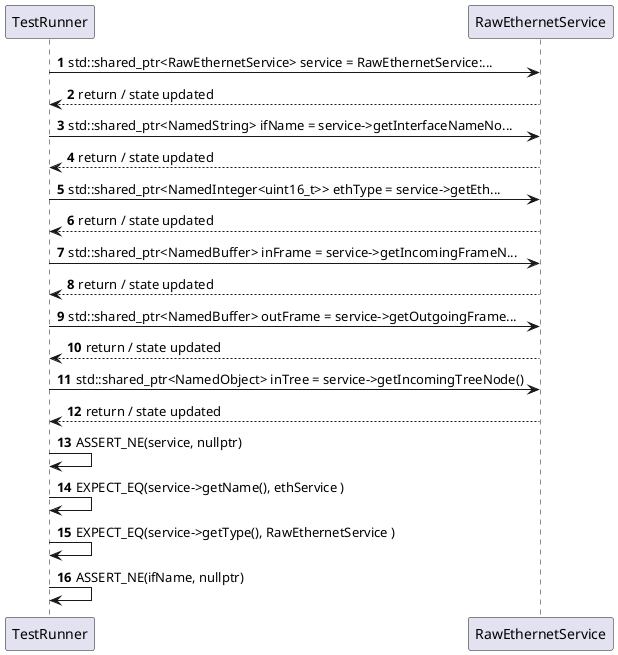

# Test Case: `TestRawEthernetService.VerifyCreationAndPropertyMapping`

| Property | Value |
| :--- | :--- |
| **Module** | `named` |
| **Source File** | `cmake-projects/named/test/TestRawEthernetService.cpp` (lines 28–65) |
| **Category** | Unit & Regression Verification |
| **Traceability** | `[TSK-20260529-001.2]` |
| **Async Telemetry** | Standard GTest / CTest stdout |

## Summary

Tests that RawEthernetService creates all mandatory child nodes and endpoints.

## Sequence Diagram

## Observed Operations

- `std::shared_ptr<RawEthernetService> service = RawEthernetService::create("ethService")`
- `std::shared_ptr<NamedString> ifName = service->getInterfaceNameNode()`
- `std::shared_ptr<NamedInteger<uint16_t>> ethType = service->getEtherTypeNode()`
- `std::shared_ptr<NamedBuffer> inFrame = service->getIncomingFrameNode()`
- `std::shared_ptr<NamedBuffer> outFrame = service->getOutgoingFrameNode()`
- `std::shared_ptr<NamedObject> inTree = service->getIncomingTreeNode()`

## Verification Assertions

- `ASSERT_NE(service, nullptr)`
- `EXPECT_EQ(service->getName(), "ethService")`
- `EXPECT_EQ(service->getType(), "RawEthernetService")`
- `ASSERT_NE(ifName, nullptr)`
- `EXPECT_EQ(ifName->getName(), "interfaceName")`
- `EXPECT_EQ(ifName->toString(), "lo")`
- `ASSERT_NE(ethType, nullptr)`
- `EXPECT_EQ(ethType->getName(), "etherType")`
- `EXPECT_EQ(ethType->value(), 0x0003); // ETH_P_ALL`
- `ASSERT_NE(inFrame, nullptr)`

---

[Back to `named` Tests Overview](../named.md)
