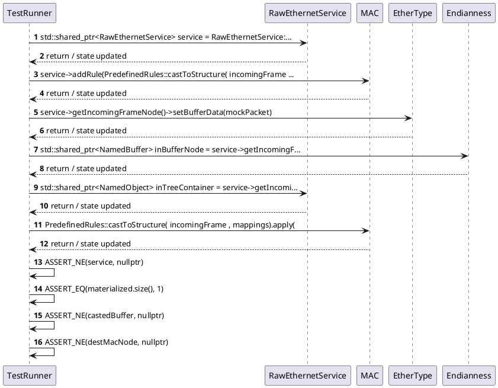

# Test Case: `TestRawEthernetService.VerifyIncomingTreeMaterialization`

| Property | Value |
| :--- | :--- |
| **Module** | `named` |
| **Source File** | `cmake-projects/named/test/TestRawEthernetService.cpp` (lines 100–159) |
| **Category** | Unit & Regression Verification |
| **Traceability** | `[TSK-20260529-001.3]` |
| **Async Telemetry** | Standard GTest / CTest stdout |

## Summary

Tests the materialization of captured packet bytes using the TreeTransformer.

## Sequence Diagram

## Observed Operations

- `std::shared_ptr<RawEthernetService> service = RawEthernetService::create("ethService")`
- `service->addRule(PredefinedRules::castToStructure("incomingFrame", mappings))`
- `service->getIncomingFrameNode()->setBufferData(mockPacket)`
- `std::shared_ptr<NamedBuffer> inBufferNode = service->getIncomingFrameNode()`
- `std::shared_ptr<NamedObject> inTreeContainer = service->getIncomingTreeNode()`
- `PredefinedRules::castToStructure("incomingFrame", mappings).apply(`
- `std::shared_ptr<NamedObject> destMacNode = castedBuffer->getChild("destMacUpper")`
- `std::shared_ptr<NamedObject> srcMacNode = castedBuffer->getChild("srcMacUpper")`

## Verification Assertions

- `ASSERT_NE(service, nullptr)`
- `ASSERT_EQ(materialized.size(), 1)`
- `ASSERT_NE(castedBuffer, nullptr)`
- `ASSERT_NE(destMacNode, nullptr)`
- `ASSERT_NE(destMac, nullptr)`
- `EXPECT_TRUE(destMac->isBound())`
- `EXPECT_EQ(destMac->value(), 0x00112233)`
- `ASSERT_NE(srcMacNode, nullptr)`
- `ASSERT_NE(srcMac, nullptr)`
- `EXPECT_EQ(srcMac->value(), 0x66778899)`

---

[Back to `named` Tests Overview](../named.md)
