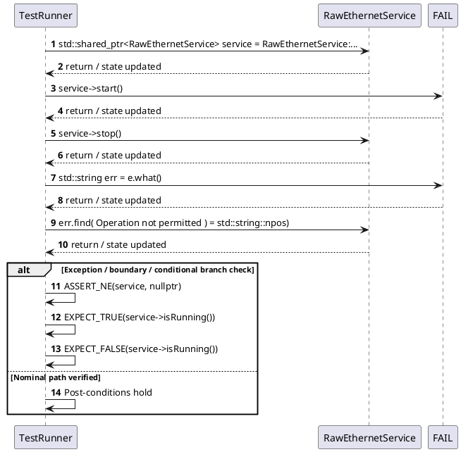

# Test Case: `TestRawEthernetService.VerifyPermissionSkippingOnStart`

| Property | Value |
| :--- | :--- |
| **Module** | `named` |
| **Source File** | `cmake-projects/named/test/TestRawEthernetService.cpp` (lines 72–93) |
| **Category** | Unit & Regression Verification |
| **Traceability** | `[TSK-20260529-001.1]` |
| **Async Telemetry** | Standard GTest / CTest stdout |

## Summary

Ensures socket initialization fails gracefully or skips if lacking permissions.

## Sequence Diagram

## Observed Operations

- `std::shared_ptr<RawEthernetService> service = RawEthernetService::create("ethService")`
- `service->start()`
- `service->stop()`
- `std::string err = e.what()`
- `err.find("Operation not permitted") != std::string::npos) {`

## Verification Assertions

- `ASSERT_NE(service, nullptr)`
- `EXPECT_TRUE(service->isRunning())`
- `EXPECT_FALSE(service->isRunning())`

---

[Back to `named` Tests Overview](../named.md)
