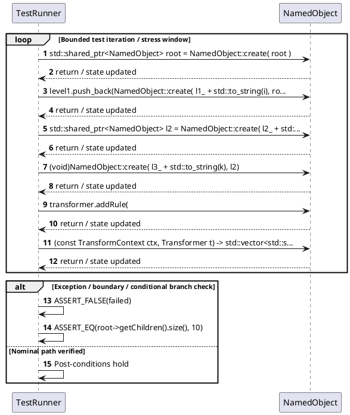

# Test Case: `TransformerStressTest.ConcurrentInPlaceTransformation`

| Property | Value |
| :--- | :--- |
| **Module** | `named` |
| **Source File** | `cmake-projects/named/test/TestTransformerStress.cpp` (lines 32–103) |
| **Category** | Determinism, Fuzzing, Concurrency & Stress (`CS-0100.7`, `CS-0100.10`, `CS-0100.11`, `CS-0100.12`) |
| **Traceability** | See module specification (`FE-*` / `TSK-*`) |
| **Async Telemetry** | Standard GTest / CTest stdout |

## Summary

Verify concurrent in-place transformation on different subtrees.

## Sequence Diagram

## Observed Operations

- `std::shared_ptr<NamedObject> root = NamedObject::create("root")`
- `level1.push_back(NamedObject::create("l1_" + std::to_string(i), root))`
- `std::shared_ptr<NamedObject> l2 = NamedObject::create("l2_" + std::to_string(j), l1)`
- `(void)NamedObject::create("l3_" + std::to_string(k), l2)`
- `transformer.addRule(`
- ` -> std::vector<std::shared_ptr<NamedObject>> {`
- `std::shared_ptr<NamedObject> node = ctx.getNode()`
- `node->setName(node->getName() + "_visited")`

## Verification Assertions

- `ASSERT_FALSE(failed)`
- `ASSERT_EQ(root->getChildren().size(), 10)`

---

[Back to `named` Tests Overview](../named.md)
