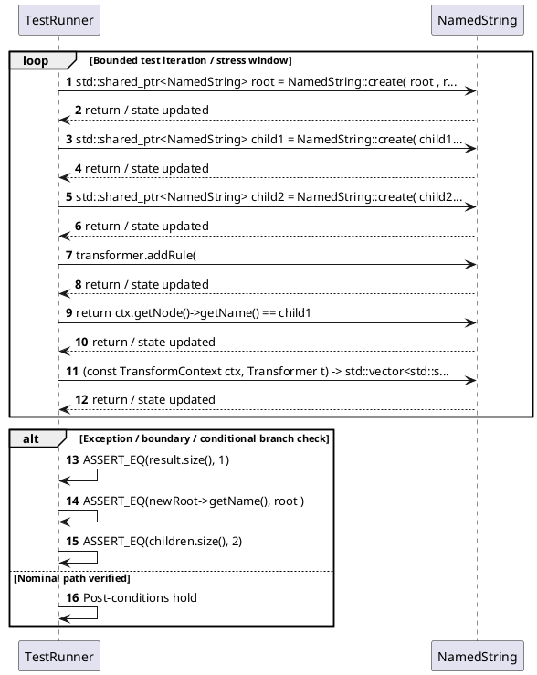

# Test Case: `TransformerTest.BasicOutwardTransformation`

| Property | Value |
| :--- | :--- |
| **Module** | `named` |
| **Source File** | `cmake-projects/named/test/TestTransformer.cpp` (lines 16–69) |
| **Category** | Unit & Regression Verification |
| **Traceability** | See module specification (`FE-*` / `TSK-*`) |
| **Async Telemetry** | Standard GTest / CTest stdout |

## Summary

Executes verification scenario `TransformerTest.BasicOutwardTransformation` defined in `cmake-projects/named/test/TestTransformer.cpp`.

## Sequence Diagram

## Observed Operations

- `std::shared_ptr<NamedString> root = NamedString::create("root", "root_val")`
- `std::shared_ptr<NamedString> child1 = NamedString::create("child1", "c1_val", root)`
- `std::shared_ptr<NamedString> child2 = NamedString::create("child2", "c2_val", root)`
- `transformer.addRule(`
- `return ctx.getNode()->getName() == "child1"`
- ` -> std::vector<std::shared_ptr<NamedObject>> {`
- `std::shared_ptr<NamedString> original = std::dynamic_pointer_cast<NamedString>(ctx.getNode())`
- `std::shared_ptr<NamedString> mod1 = NamedString::create("child1_a", original->toString() + "_a")`

## Verification Assertions

- `ASSERT_EQ(result.size(), 1)`
- `ASSERT_EQ(newRoot->getName(), "root")`
- `ASSERT_EQ(children.size(), 2)`
- `ASSERT_TRUE(foundA)`
- `ASSERT_TRUE(foundB)`

---

[Back to `named` Tests Overview](../named.md)
