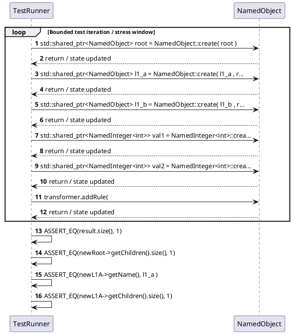

# Test Case: `TransformerTest.ComplexTreeTransformation`

| Property | Value |
| :--- | :--- |
| **Module** | `named` |
| **Source File** | `cmake-projects/named/test/TestTransformer.cpp` (lines 109–168) |
| **Category** | Unit & Regression Verification |
| **Traceability** | See module specification (`FE-*` / `TSK-*`) |
| **Async Telemetry** | Standard GTest / CTest stdout |

## Summary

Executes verification scenario `TransformerTest.ComplexTreeTransformation` defined in `cmake-projects/named/test/TestTransformer.cpp`.

## Sequence Diagram

## Observed Operations

- `std::shared_ptr<NamedObject> root = NamedObject::create("root")`
- `std::shared_ptr<NamedObject> l1_a = NamedObject::create("l1_a", root)`
- `std::shared_ptr<NamedObject> l1_b = NamedObject::create("l1_b", root)`
- `std::shared_ptr<NamedInteger<int>> val1 = NamedInteger<int>::create("val1", 10, l1_a)`
- `std::shared_ptr<NamedInteger<int>> val2 = NamedInteger<int>::create("val2", 20, l1_b)`
- `transformer.addRule(`
- `return std::dynamic_pointer_cast<NamedInteger<int>>(ctx.getNode()) != nullptr`
- ` -> std::vector<std::shared_ptr<NamedObject>> {`

## Verification Assertions

- `ASSERT_EQ(result.size(), 1)`
- `ASSERT_EQ(newRoot->getChildren().size(), 1)`
- `ASSERT_EQ(newL1A->getName(), "l1_a")`
- `ASSERT_EQ(newL1A->getChildren().size(), 1)`
- `ASSERT_NE(newVal1, nullptr)`
- `ASSERT_EQ(newVal1->getName(), "val1_mult")`
- `ASSERT_EQ(newVal1->value(), 20)`

---

[Back to `named` Tests Overview](../named.md)
