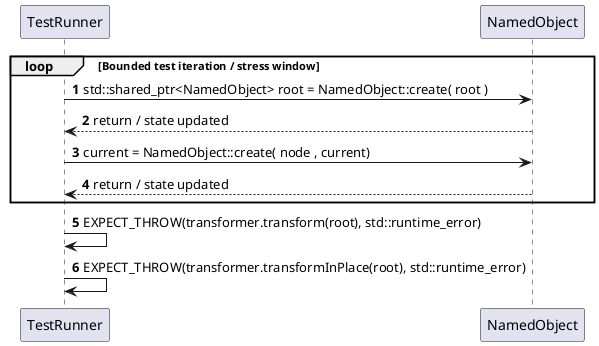

# Test Case: `TransformerTest.RecursionLimit`

| Property | Value |
| :--- | :--- |
| **Module** | `named` |
| **Source File** | `cmake-projects/named/test/TestTransformer.cpp` (lines 170–182) |
| **Category** | Unit & Regression Verification |
| **Traceability** | See module specification (`FE-*` / `TSK-*`) |
| **Async Telemetry** | Standard GTest / CTest stdout |

## Summary

Executes verification scenario `TransformerTest.RecursionLimit` defined in `cmake-projects/named/test/TestTransformer.cpp`.

## Sequence Diagram

## Observed Operations

- `std::shared_ptr<NamedObject> root = NamedObject::create("root")`
- `current = NamedObject::create("node", current)`

## Verification Assertions

- `EXPECT_THROW(transformer.transform(root), std::runtime_error)`
- `EXPECT_THROW(transformer.transformInPlace(root), std::runtime_error)`

---

[Back to `named` Tests Overview](../named.md)
