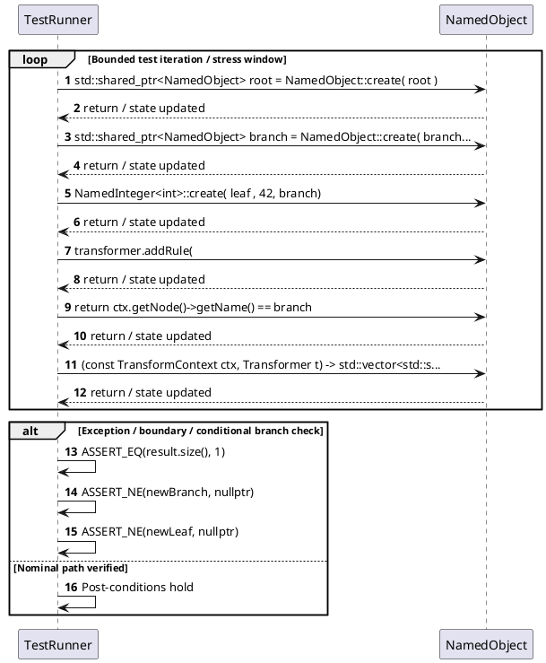

# Test Case: `TransformerTest.RecursiveModification`

| Property | Value |
| :--- | :--- |
| **Module** | `named` |
| **Source File** | `cmake-projects/named/test/TestTransformer.cpp` (lines 184–224) |
| **Category** | Unit & Regression Verification |
| **Traceability** | See module specification (`FE-*` / `TSK-*`) |
| **Async Telemetry** | Standard GTest / CTest stdout |

## Summary

Executes verification scenario `TransformerTest.RecursiveModification` defined in `cmake-projects/named/test/TestTransformer.cpp`.

## Sequence Diagram

## Observed Operations

- `std::shared_ptr<NamedObject> root = NamedObject::create("root")`
- `std::shared_ptr<NamedObject> branch = NamedObject::create("branch", root)`
- `NamedInteger<int>::create("leaf", 42, branch)`
- `transformer.addRule(`
- `return ctx.getNode()->getName() == "branch"`
- ` -> std::vector<std::shared_ptr<NamedObject>> {`
- `std::shared_ptr<NamedObject> newBranch = NamedObject::create("branch_mod")`
- `std::vector<std::shared_ptr<NamedObject>> transformed = t.transformSubtree(child, ctx.getDepth() + 1, ctx.getPath() + "/" + child->getName())`

## Verification Assertions

- `ASSERT_EQ(result.size(), 1)`
- `ASSERT_NE(newBranch, nullptr)`
- `ASSERT_NE(newLeaf, nullptr)`
- `ASSERT_EQ(newLeaf->getType(), "NamedInteger")`

---

[Back to `named` Tests Overview](../named.md)
