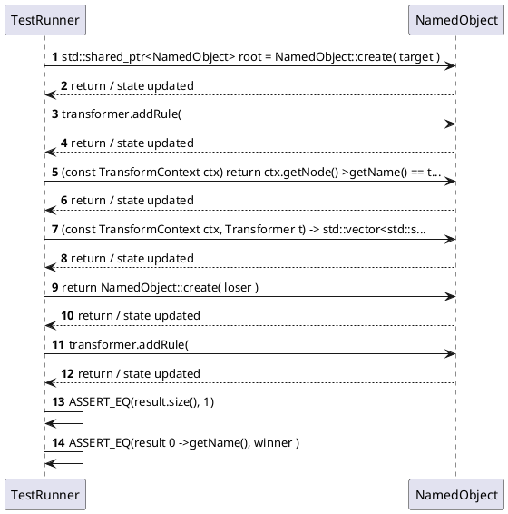

# Test Case: `TransformerTest.RulePriority`

| Property | Value |
| :--- | :--- |
| **Module** | `named` |
| **Source File** | `cmake-projects/named/test/TestTransformer.cpp` (lines 226–254) |
| **Category** | Unit & Regression Verification |
| **Traceability** | See module specification (`FE-*` / `TSK-*`) |
| **Async Telemetry** | Standard GTest / CTest stdout |

## Summary

Executes verification scenario `TransformerTest.RulePriority` defined in `cmake-projects/named/test/TestTransformer.cpp`.

## Sequence Diagram

## Observed Operations

- `std::shared_ptr<NamedObject> root = NamedObject::create("target")`
- `transformer.addRule(`
- ` { return ctx.getNode()->getName() == "target"; },`
- ` -> std::vector<std::shared_ptr<NamedObject>> {`
- `return {NamedObject::create("loser")}`
- `transformer.addRule(`
- ` { return ctx.getNode()->getName() == "target"; },`
- ` -> std::vector<std::shared_ptr<NamedObject>> {`

## Verification Assertions

- `ASSERT_EQ(result.size(), 1)`
- `ASSERT_EQ(result[0]->getName(), "winner")`

---

[Back to `named` Tests Overview](../named.md)
