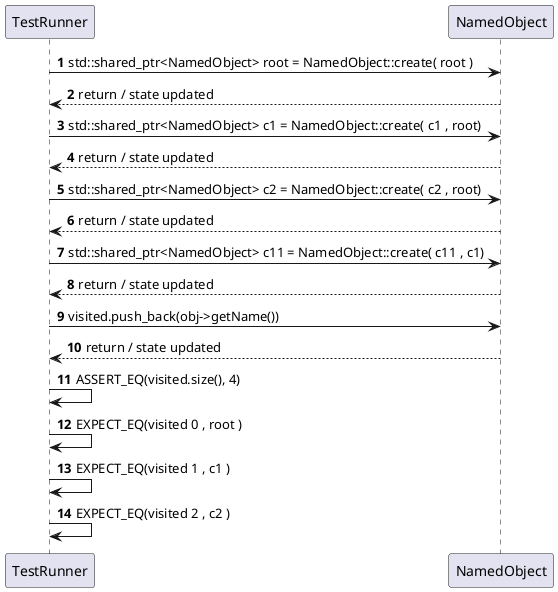

# Test Case: `TraversalTest.BFS`

| Property | Value |
| :--- | :--- |
| **Module** | `named` |
| **Source File** | `cmake-projects/named/test/TestTraversal.cpp` (lines 37–63) |
| **Category** | Unit & Regression Verification |
| **Traceability** | See module specification (`FE-*` / `TSK-*`) |
| **Async Telemetry** | Standard GTest / CTest stdout |

## Summary

Executes verification scenario `TraversalTest.BFS` defined in `cmake-projects/named/test/TestTraversal.cpp`.

## Sequence Diagram

## Observed Operations

- `std::shared_ptr<NamedObject> root = NamedObject::create("root")`
- `std::shared_ptr<NamedObject> c1 = NamedObject::create("c1", root)`
- `std::shared_ptr<NamedObject> c2 = NamedObject::create("c2", root)`
- `std::shared_ptr<NamedObject> c11 = NamedObject::create("c11", c1)`
- `visited.push_back(obj->getName())`

## Verification Assertions

- `ASSERT_EQ(visited.size(), 4)`
- `EXPECT_EQ(visited[0], "root")`
- `EXPECT_EQ(visited[1], "c1")`
- `EXPECT_EQ(visited[2], "c2")`
- `EXPECT_EQ(visited[3], "c11")`

---

[Back to `named` Tests Overview](../named.md)
