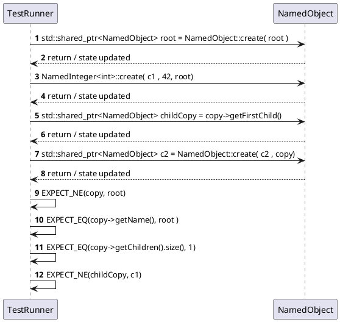

# Test Case: `TraversalTest.DeepCopy`

| Property | Value |
| :--- | :--- |
| **Module** | `named` |
| **Source File** | `cmake-projects/named/test/TestTraversal.cpp` (lines 90–155) |
| **Category** | Unit & Regression Verification |
| **Traceability** | See module specification (`FE-*` / `TSK-*`) |
| **Async Telemetry** | Standard GTest / CTest stdout |

## Summary

Executes verification scenario `TraversalTest.DeepCopy` defined in `cmake-projects/named/test/TestTraversal.cpp`.

## Sequence Diagram

## Observed Operations

- `std::shared_ptr<NamedObject> root = NamedObject::create("root")`
- `NamedInteger<int>::create("c1", 42, root)`
- `std::shared_ptr<NamedObject> childCopy = copy->getFirstChild()`
- `std::shared_ptr<NamedObject> c2 = NamedObject::create("c2", copy)`

## Verification Assertions

- `EXPECT_NE(copy, root)`
- `EXPECT_EQ(copy->getName(), "root")`
- `EXPECT_EQ(copy->getChildren().size(), 1)`
- `EXPECT_NE(childCopy, c1)`
- `EXPECT_EQ(childCopy->getName(), "c1")`
- `ASSERT_TRUE(intCopy != nullptr)`
- `EXPECT_EQ(intCopy->toInt(), 42)`
- `EXPECT_EQ(copy->getChildren().size(), 2)`
- `EXPECT_EQ(root->getChildren().size(), 1)`

---

[Back to `named` Tests Overview](../named.md)
